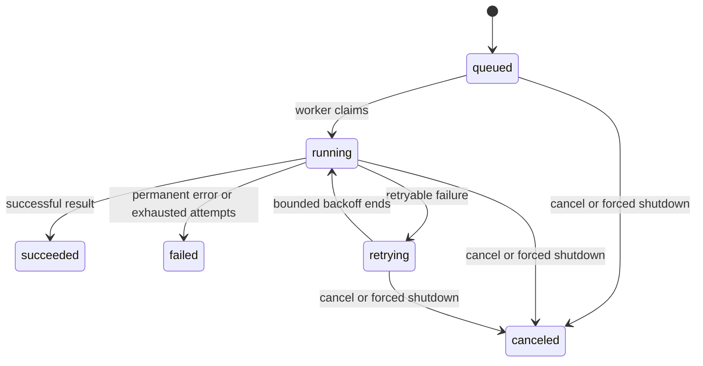
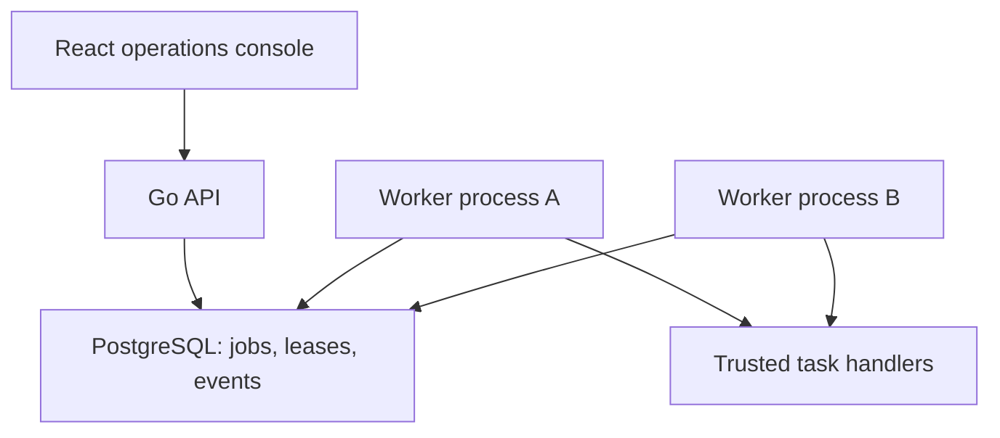

# Architecture and decisions

## Problem and scope

Internal platforms need to accept background work, bound execution, explain failures and let operators intervene. Small Chain makes those contracts inspectable in a small codebase. A checksum task is a safe deterministic workload for exercising the scheduler; it is not a performance benchmark or an untrusted build sandbox.

M1 is one Go binary with three boundaries: HTTP transport, lifecycle engine, and a cooperative executor function. There is no speculative repository abstraction: a durable scheduler needs transactional claim/finish operations, not generic CRUD. M2.1–M2.7 add durable admission, claims, fencing, recovery, a bounded worker and retention. M2.8 puts the HTTP contract on that store without an in-memory queue as a second source of truth; M2.9 owns the retention cadence in that API process. M2.10 begins transactionally consistent lifecycle history, and M2.11 covers every low-frequency transition.

## State machine

Timeout is a terminal failure in M1, since blindly retrying deadlines can amplify overload. Only errors wrapped with `jobs.Retryable` are retried. Panic recovery records a permanent failure and keeps the worker alive; it does not expose panic contents to clients.

## Invariants and concurrency ownership

1. Concurrent submissions of the same key and normalized request create one job. Reusing a key for a different spec conflicts. Keys are validated, retained, and never logged.
2. Enqueue and record/key insertion occur under one mutex. A worker may receive the ID immediately, but cannot read its record until admission releases the mutex. A full channel commits neither record nor key.
3. Exactly `workers` worker goroutines execute tasks. A bounded channel prevents unbounded pending work. HTTP uses Go's normal per-connection goroutines; this is not a global connection limit.
4. All record mutations use the engine mutex. `Get` returns a value copy with no shared mutable members. Executor code never runs with that mutex held.
5. Terminal states are immutable. Cancellation wins if it acquires the state lock before completion; otherwise a finished task returns 409 on cancel. A late executor result cannot undo cancellation.
6. `StopAdmission` closes the queue under the same mutex used by submission, preventing send-on-closed-channel races. Workers drain it before exiting.
7. Retained jobs and keys are capped together. This bounds record count, not all process memory: HTTP buffers, goroutine stacks and runtime overhead also consume memory. Input size and HTTP deadlines add separate bounds.

An attempt gets a child deadline of the job context, canceled immediately after return. A result returned after its deadline fails even with nil executor error. Runtime shutdown uses one total budget for HTTP drain plus worker drain; expiry cancels all nonterminal jobs and returns an error exit status.

## Explicit tradeoffs

| Decision | Benefit | Cost / upgrade trigger |
| --- | --- | --- |
| Standard library only in M1 | Small dependency surface, easy review/startup | Adopt maintained metrics/OTel libraries for histograms/traces |
| One mutex for state | Simple atomic admission and transitions | Profile contention first; metrics snapshots scan bounded records |
| Backoff sleeps inside worker | No extra scheduler goroutines or timer heap | Retrying work consumes slots; M2 uses `available_at` and releases claims during delays |
| Canceled queued IDs remain in channel | No unsafe channel-removal protocol | Capacity reclaimed when a worker dequeues the tombstone |
| Retain terminal records up to cap | Stable idempotency during process lifetime | Finite demo lifetime; M2 adds documented retention/expiration |
| Fixed trusted executor | Reproducible fault injection | Untrusted CI execution needs a separate isolation design |

## M2.1: durable admission (implemented; unwired at that increment)

`internal/postgres` persists normalized specs and SHA-256 fingerprints, with a
unique key and explicit READ COMMITTED transactions. Replays use a separate
statement after conflict to see a concurrent winner. `cmd/migrate` serializes
migration execution with a transaction advisory lock and verifies checksummed
history. At the M2.1 migration boundary the schema restricts state to queued and
attempts to zero; the following migration expands those invariants for claims.
Database connection/query/lock waits are bounded. Full protocol, retention
limitations and real-database tests are in [the PostgreSQL guide](postgres.md).
At that increment the M1 HTTP/worker process was unchanged; M2.8 now exposes the
store through the API.

## M2.2: transactional claims (implemented; unwired at that increment)

Migration `0002_leases.sql` persists `max_attempts`, `available_at`, lease owner,
monotonic version and expiry. Database constraints couple `running` state to a
complete lease and keep attempts within the normalized request budget. A partial
`(available_at, id)` index contains only queued/retrying rows.

`ClaimDue` validates batch/lease bounds, opens a short READ COMMITTED transaction,
then selects due rows in deterministic order with `FOR UPDATE SKIP LOCKED` and
updates them in one statement. Claiming increments attempts and lease version,
sets expiry from PostgreSQL `statement_timestamp()`, and commits before returning.
Two independent pools can therefore claim different rows without coordinating in
Go. A returned `(owner, version)` is consumed by the M2.3 lifecycle operations.
An ambiguous commit returns no work, so the caller must not execute anything.

Claim alone does **not** make lease expiry actionable: `RecoverExpired` must run
before an expired row becomes available again. Heartbeat, finish/retry/cancel and
recovery are implemented store operations. Later increments added worker
execution, HTTP persistence and append-only lifecycle events. This avoids
presenting a database row lock as end-to-end crash recovery.

## M2.3: fenced lifecycle writes (implemented; unwired at that increment)

Migration `0003_outcomes.sql` stores bounded results and errors and constrains
them to valid lifecycle states. It backfills terminal/retrying rows permitted by
the previous schema before enabling the constraint, so the migration works on a
non-empty database rather than only on a fresh test schema.

Heartbeat, completion and failure all execute as one conditional `UPDATE`. They
match job ID, owner, version, running state, and an expiry later than PostgreSQL
`statement_timestamp()`. A mismatch returns `ErrStaleLease`; an expired worker
cannot revive its own lease. Heartbeat extends expiry from database time.
Successful completion clears the lease with its result. Failure either records a
delayed retry and releases the lease or becomes terminal when the persisted
attempt budget is exhausted.

Cancellation is an authoritative operator action rather than a lease action. It
can transition queued, running or retrying jobs, increments `lease_version`, and
clears lease fields in the same statement. Repeating cancellation is idempotent;
a competing terminal completion yields exactly one winner. These operations keep
transactions shorter than task execution and backoff: no transaction is held
while user work runs.

This is state-write fencing, not exactly-once execution. Fencing cannot roll back
an external side effect produced before a stale worker's result is rejected.

## M2.4: expired-lease recovery (implemented)

Migration `0004_recovery.sql` adds a partial `(lease_expires_at, id)` index for
running rows. `RecoverExpired` validates a batch and retry-delay bound, then uses
one statement to lock expired rows in deterministic lease order with `FOR UPDATE
SKIP LOCKED` and update them. Attempts below `max_attempts` become `retrying` at
database-time plus the delay; exhausted attempts become `failed`. Both paths
record a fixed reason, advance `lease_version`, and clear owner/expiry.

The statement is its own short transaction: no task execution or backoff occurs
while locks are held. Concurrent sweepers skip each other's rows, and later
sweeps ignore the transitioned rows. A stale worker cannot heartbeat or finish
after recovery. Recovery is deliberately explicit rather than hidden inside
`ClaimDue`, so the M2.5 worker schedules and can later observe it independently.

This completes the database transition needed after a worker crash. M2.5 calls
the sweep periodically, and M2.6 verifies it after killing a worker process.

## M2.5: bounded database worker (implemented as a package)

`internal/dbworker.Worker` owns one polling/recovery loop and a semaphore-sized
set of in-flight attempts. It asks `ClaimDue` for no more than its free slots,
so polling never creates an unbounded local queue. A claim transaction is fully
committed before the executor starts. Heartbeats and final writes are separate,
bounded database operations; no transaction spans task execution or retry wait.

Each executor receives the persisted attempt timeout and must cooperate with
context cancellation. Losing a heartbeat cancels that context, waits for the
trusted handler to return, and deliberately writes no result. The recovery path
can then advance the fencing version and retry the work. Success, explicitly
retryable error, and permanent error take distinct fenced store paths; panic text
is not persisted. Retry delay uses capped exponential equal jitter.

Canceling `Run` stops polling and recovery before waiting for already claimed
attempts. Those attempts retain their independent deadlines and heartbeats while
draining; this avoids abandoning a committed lease merely because the process
received a graceful shutdown signal. Unit tests use the race detector to prove
the concurrency bound, drain order and lease-loss behavior. A PostgreSQL test
executes a task longer than its initial lease, retries a transient failure and
recovers an expired claim. M2.6 exposes the package through a dedicated command
and adds the process-level recovery evidence.

## M2.6: worker process and crash recovery (implemented)

`cmd/small-chain-worker` is a narrow process boundary around the durable worker.
Every live process requires a distinct stable owner; concurrency, polling,
leases, heartbeats, retry and recovery bounds are explicit flags. The connection
string is accepted only through `DATABASE_URL`, so credentials do not appear in
the command line. Migrations remain a separate command and privilege boundary.

SIGTERM cancels polling and recovery before the worker drains already claimed
attempts. SIGKILL cannot run cleanup, so the row remains `running` until its
database-time lease expires. Another live worker's bounded recovery sweep then
changes it to `retrying`, advances the fencing version and reclaims it as the
next persisted attempt.

The integration test builds a race-instrumented worker binary, starts two real
Linux child processes against a disposable PostgreSQL schema, captures worker
A's fencing token, and sends A SIGKILL. Worker B recovers the lease and completes
attempt two. The test also submits A's captured token after completion and
requires `ErrStaleLease`. This proves process-level scheduler recovery, not
exactly-once external effects or durable HTTP admission.

## M2.7: bounded durable admission and replay (implemented)

Migration `0005_retention.sql` creates a singleton database policy with a
retained-job count, cap and minimum replay window. `AFTER INSERT` and `AFTER
DELETE` triggers update that row transactionally. The insert trigger advances
the counter only when a slot exists and raises a named check violation otherwise;
the Go store maps only that named violation to `jobs.ErrCapacity`. Because the
trigger runs after insertion, `ON CONFLICT DO NOTHING` replays do not consume a
slot. The database default is 10,000 records and 24 hours; an upgrade with more
than 10,000 existing rows preserves all rows and starts at its current count.

Submission first locks an existing idempotency-key row. This prevents terminal
cleanup from removing a visible replay before its transaction commits. If the
key was initially absent, concurrent creators still use the unique constraint
and a new READ COMMITTED statement. Newly created rows cannot be cleanup-eligible
inside the minimum one-minute replay window. Existing keys therefore replay or
conflict even while the store is full; capacity applies only to new work.

`PurgeTerminal` locks the policy for a stable window, then deletes at most 1,000
eligible rows in deterministic `(updated_at, id)` order with `FOR UPDATE SKIP
LOCKED`. Only succeeded, failed and canceled rows can match. The window starts at
the terminal transition's database `updated_at`; queued, running and retrying
rows are never age-deleted. The window is a minimum guarantee, not an exact TTL:
after it passes the key still replays until a purge removes it, and reuse after
removal creates a new job ID.

## M2.8: PostgreSQL-backed HTTP mode (implemented)

`cmd/small-chain -storage=postgres` opens the store from `DATABASE_URL` and
constructs the HTTP adapter without creating the memory engine or queue. Submit
returns 202 only after `Store.Submit` commits; replay, conflict and capacity map
to the same public contract as memory mode. Get and cancel read/write the same
rows consumed by independent worker processes. Startup does not run migrations.

Readiness performs a bounded database ping and becomes 503 while draining or
when connectivity is lost. Shutdown closes HTTP admission before the store. The
PostgreSQL adapter intentionally exposes no process-local job gauges: only HTTP
counters and `small_chain_backend_info` are emitted until durable metrics are
designed. A real-binary integration test admits a record, reaches capacity,
restarts the API on the same schema, and verifies replay, lookup, conflict,
cancellation and backend identity.

## M2.9: retention maintenance (implemented)

PostgreSQL API mode runs one bounded purge at startup and then on
`-retention-interval` (one minute by default), deleting at most
`-retention-batch` rows (100 by default). One goroutine calls the store serially,
so slow sweeps cannot overlap or grow an unbounded queue. A failed sweep emits
`maintenance.retention_failed` and the next cadence retries; readiness continues
to describe admission and database connectivity, not the most recent background
maintenance result.

Shutdown stops HTTP admission, cancels any in-flight purge, waits for the loop,
and only then closes the PostgreSQL pool. A unit test proves failure/retry,
single-flight execution and context cancellation. The real API process test
ages a canceled row outside the replay window and proves the scheduled sweep
releases a one-row capacity limit before SIGTERM exits cleanly.

## M2.10: transactional event foundation (implemented)

Migration `0006_job_events.sql` adds retained, append-only lifecycle history.
Each newly created job receives exactly one `submitted` event; replay and
conflict do not create another. Each successful claim receives one `claimed`
event keyed by `(job_id, lease_version)`, carrying the persisted attempt and
owner. The claim update and event insert are data-modifying CTEs in the same
statement and transaction. If either side fails, neither becomes visible.

The migration backfills a `submitted` event at the original `jobs.created_at`
for existing rows, because that is the only transition timestamp the schema can
prove. It deliberately does not invent historical claims or outcomes. Events
use monotonic IDs for stable per-job ordering and are removed by the existing
job retention transaction through `ON DELETE CASCADE`; “append-only” therefore
means no in-place mutation during the retained job lifetime, not an eternal
audit archive.

Failure-injection integration tests reject event inserts and require the job
insert, shared capacity counter, claim state, attempt and fencing version all to
roll back. Concurrent admission and two-pool claims require one submission
event and one unique claim event per lease version.

## M2.11: complete lifecycle event coverage (implemented)

Migration `0007_outcome_events.sql` adds the resulting state and an optional
bounded message to each event. Success, scheduled retry, worker failure, expired
lease recovery and operator cancellation now use a data-modifying CTE that
inserts evidence from the row changed by that same statement. An event failure
therefore aborts the state change instead of leaving an unexplained transition.

Worker events retain the owner/version that authorized the change. Recovery
retains the expired owner and the newly advanced fencing version; cancellation
retains its new fence. Partial unique indexes enforce one worker outcome per
lease, one recovery per recovery fence and one terminal event per job. Heartbeat
renewals remain intentionally absent because they are high-frequency liveness,
not lifecycle transitions. Integration tests prove completion rollback, unique
events from concurrent sweepers and exactly one terminal event when completion
races cancellation.

## M2.12: bounded event reads (implemented)

`ListEvents` uses the existing `(job_id, id)` index for exclusive, forward
cursor pagination. One `jobs` to `LATERAL job_events` query distinguishes a
missing job from an existing job with no later events in the same MVCC
snapshot, including during concurrent retention. It fetches at most one row
beyond the requested page to decide whether to return `next_cursor`; page size
is capped at 100.

The HTTP endpoint validates decimal cursors before reaching the database and
returns event IDs and cursors as strings so JavaScript clients do not lose
64-bit integer precision. The cursor is an opaque ordering token rather than an
offset: clients can repeat their last event ID later to observe a newly appended
transition without re-reading earlier evidence. Memory mode returns an explicit
501 because it does not retain equivalent history.

## Durable scheduling architecture

Keep one database and the same binary with API/worker modes. Add migrations, a database integration suite and Compose. Do not keep an in-memory channel as a second source of truth.

Implemented `jobs` records contain `id, idempotency_key, request_fingerprint, spec, state, attempts, max_attempts, available_at, lease_owner, lease_version, lease_expires_at, result, error, created_at, updated_at`. A singleton row bounds retained records and defines replay retention. `job_events` covers every low-frequency lifecycle transition. Tenant scoping is deferred until authentication exists.

Use partial indexes restricted to eligible queued/retrying states and running leases, with deterministic `(available_at, id)` claim ordering. Validate with `EXPLAIN (ANALYZE, BUFFERS)` on representative distributions before claiming an optimization. Bound the Go connection pool and transaction/statement timeouts; never hold a database transaction during task execution or backoff.

Claim protocol:

1. **Implemented with events:** in a short transaction, select due jobs with `FOR UPDATE SKIP LOCKED`, update state, increment attempt and lease version, set expiry and insert the matching claim event. Commit before execution.
2. **Implemented in the worker package:** execute outside the transaction. Heartbeat only while owner/version still matches. Use database time for lease comparisons.
3. **Implemented with events:** finish with a conditional update on ID, owner, version, running state and unexpired lease. Stale completion affects zero rows and writes no event.
4. **Implemented as store operations:** on attempt failure, set `available_at` and clear the lease atomically. A bounded concurrent-safe sweep recovers expired leases using the persisted attempt limit and advances the fencing version.
5. **Store and worker fencing implemented:** on cancellation, persist canceled state and increment lease version. Heartbeat loss stops the worker from writing a late result; cancellation cannot undo an external side effect.

PostgreSQL describes `SKIP LOCKED` as useful for queue-like consumers, with an inconsistent view unsuitable for general-purpose reads: [official SELECT documentation](https://www.postgresql.org/docs/current/sql-select.html). Use it for task claims, not complete user-facing job lists.

| Crash / race | Required behavior and test |
| --- | --- |
| Commit succeeds but client loses response | Same-key retry returns committed job |
| Worker dies after claim | Lease expires; another worker retries within budget |
| Old worker returns after reassignment | Version check rejects stale completion |
| Side effect succeeds before result commit | Duplicate execution possible; downstream idempotency required |
| Cancellation races with completion | Transactional state/version condition selects one terminal result |
| Database unavailable at submit | Reject; never acknowledge non-durable work |

Delivery semantics are **at least once**, with fenced state writes. Exactly-once external side effects are not promised. Lease fencing protects database state only; downstream systems need their own idempotency or fencing protocol.

## M3.1: operations job list (implemented)

`ListJobs` serves lightweight summaries rather than full specs/results and caps
each page at 100 rows. Newest-first keyset pagination orders by
`(created_at, id)`, using the ID as a deterministic tie-breaker. Separate
`(created_at, id)` and `(state, created_at, id)` indexes support the unfiltered
and state-filtered access paths without using queue-oriented `SKIP LOCKED`.

The HTTP cursor is opaque base64url JSON containing a version, position and
state filter. Binding the filter prevents a client from accidentally continuing
a queued page as a failed page. Inserts newer than the cursor cannot shift later
pages as they would with `OFFSET`; retention may still remove unseen rows, so
the API does not claim a snapshot spanning requests. Memory mode returns 501 to
keep the operations contract tied to durable state.

## Target architecture after M3 (planned)

M3.2 implements the first read-only UI slice in `web/`: a separate Vite build
using relative `/v1` requests and a loopback development proxy. The typed client
checks the response shape at runtime, preserves structured API errors and caps
requested pages at 20. State filters reset the cursor chain. Abort signals and
request versions keep stale first-page or older-page responses from overwriting
the active filter; failed older pages preserve already loaded rows for retry.
There is no automatic polling or implied live snapshot. Tables retain readable
state text, UTC timestamps and keyboard-accessible horizontal scrolling.
Deployment and browser E2E remain planned; M3.4 adds the cancellation workflow below.

M3.3 adds a selected-job detail view. Snapshot and retained event history are
independent requests started in parallel; one resource can fail and retry while
the other remains readable. They are separate database reads, so the UI does not
claim a shared snapshot or infer current state from the last loaded event. Each
event page requests at most 20 rows and appends oldest-first. Decimal event IDs
and cursors remain strings through parsing, rendering and subsequent requests.
The UI deliberately omits the numeric lease version rather than claiming safe
64-bit precision for that JSON number.

Changing or closing the selected job unmounts its resource components, aborts
in-flight requests and prevents late results from mutating the next selection.
An older event-page failure preserves the loaded history and retries the same
cursor. A 404 explains the retention boundary instead of presenting an empty
history as evidence that the job never existed. React component and typed-client
tests verify these transitions; browser visual QA and real-backend E2E are still
unverified.

M3.4 connects the existing cancellation endpoint to the detail snapshot. Only
queued/running/retrying snapshots offer the action, which requires a separate
confirmation explaining cooperative cancellation and irreversible side effects.
A synchronous ref guard and disabled controls allow only one in-flight POST.
The typed client validates that a successful response identifies the requested
job and confirms canceled state. No local optimistic state transition is used.

Every settled cancel attempt remounts snapshot/history resources and restarts
the filtered job list from its first page, discarding obsolete list cursors.
A 409 means completion won the race: the UI explains that result and reloads
authoritative state. A transport failure is explicitly uncertain because commit
may have succeeded before the response was lost; the UI reads state again and
does not automatically repeat the mutation. Read failures remain independently
retryable. Closing or switching the detail aborts pending fetches and ignores
late callbacks, but cannot undo a cancellation already committed by the API.
These behaviors have component/client coverage. M3.5 adds the real-backend
browser boundary below; subjective cross-browser visual QA remains outside the
automated acceptance test.

## M3.5: bounded real-stack browser workflow (implemented)

The Playwright workflow is deliberately one end-to-end reliability assertion,
not a second integration suite. A disposable PostgreSQL service is migrated,
then the compiled API, one database worker and Vite start as separate processes.
The test submits a delayed checksum job through the same relative `/v1` path as
the browser, waits until the worker's committed lease is visible, filters and
selects that row, and requires the persisted `claimed` event and worker owner.
It confirms cancellation in the UI and finally reads the authoritative
`canceled` state back through HTTP.

One browser worker avoids inter-test database interference. Readiness waits are
20 seconds, the test is capped at 30 seconds, and the CI job at 15 minutes.
The shell harness terminates every child process and prints bounded logs on
failure. Unit tests remain separate: Vitest only searches `src/**/*.test.*`, so
it cannot accidentally load Playwright specs. Traces and screenshots are kept
on Playwright failures; their existence is diagnostic evidence, not a claim of
successful visual review.

The console adds filtered job lists, details, attempts and cancellation. Playwright proves the workflow. Kubernetes, DAG scheduling, multi-region replication, billing, arbitrary code execution and blockchain consensus are outside the portfolio release scope.

## M4.1: authoritative durable state gauges (implemented)

The API keeps HTTP counters process-local because they describe that process,
but PostgreSQL job-state gauges come from PostgreSQL. Each `/metrics` scrape
runs one `GROUP BY state` query over the retention-bounded `jobs` table with an
outer one-second request budget. The exporter writes all six known states,
including zeroes, from one query result so a dashboard does not retain a missing
series merely because a state is empty.

Database failure is data, not a zero count. The endpoint continues to expose
backend identity and process counters with HTTP 200, publishes
`small_chain_job_state_metrics_up 0`, logs `metrics.job_state_read_failed`, and
omits every `small_chain_jobs` series for that scrape. This lets Prometheus alert
on collection health without confusing an unavailable source with an empty
queue. No cross-scrape snapshot, attempt histogram, percentile, SLO or
throughput claim is implied.

## M4.2: process-local durable attempt histogram (implemented)

The durable worker measures one boundary: wall-clock time inside the trusted
executor call. It starts after a committed claim reaches the handler and stops
when that handler returns, including cooperative timeout, lease-loss
cancellation and recovered panic. Claim polling, heartbeat calls, retry delay
and fenced outcome persistence are intentionally outside the observation, so
the histogram is not presented as end-to-end job latency.

Each process keeps 12 fixed cumulative buckets from 5 milliseconds through the
30-second accepted task timeout, plus `+Inf`, count and sum. A mutex makes an
individual scrape internally consistent while preserving the worker's bounded
100-attempt concurrency. There are no job IDs, owners, outcomes or other
unbounded labels. `-metrics-addr` is opt-in and should be a distinct loopback
address for each worker; the series resets on process restart and Prometheus is
expected to supply its normal instance identity when scraping multiple workers.

This is raw measurement plumbing, not a latency result. Percentiles require a
documented workload and must be calculated from aggregated histogram buckets;
no production distribution, SLO or end-to-end timing claim follows from the
unit tests.

## M4.3: health-ordered local Compose stack (implemented)

The foundational application stack has four services and one database volume. PostgreSQL must
pass `pg_isready` before the one-shot migration container runs. The API and
worker both require that migration to exit successfully, so an incompatible or
failed schema never produces a superficially healthy application process.
Their health checks use a small static Go probe included in the same non-root
scratch image: the API must answer `/readyz` and the worker metrics server must
answer `/metrics`.

PostgreSQL has no published host port. The unauthenticated API and worker
metrics bind only to host loopback. The API receives 12 seconds to drain HTTP
work; the worker receives 35 seconds, covering the accepted 30-second executor
timeout. Runtime restart attempts are capped at three. Normal teardown preserves
the named database volume, while the explicit clean target deletes it.

The Compose smoke test uses a unique project, waits at most 60 seconds per
endpoint, submits a checksum job and requires durable success plus API and
worker metrics. Its exit trap prints service evidence on failure and always
removes containers and the test volume. This proves the local startup and task
path in CI; it is not a production deployment topology or availability claim.

## M4.4: provisioned local observability (implemented)

Prometheus starts only after the API and worker health checks pass, then scrapes
their private Compose addresses every five seconds. Its host UI binds to
loopback and its named volume retains at most 24 hours for repeatable local
inspection. Grafana starts after Prometheus health, uses a provisioned data
source with a stable UID and loads an immutable dashboard JSON from the
repository. Dashboard state therefore does not depend on manual UI clicks.

The dashboard keeps source and collection failure visible. Prometheus `up`
shows whether each endpoint was scraped, while
`small_chain_job_state_metrics_up` distinguishes a database-read failure from
real zero-state gauges. Worker panels show the monotonic attempt count, the
five-minute mean calculated from histogram sum/count, and the raw cumulative
fixed-bucket rate. They do not calculate a percentile or apply an alert/SLO
threshold because the repository does not yet contain a controlled workload
measurement that could justify one.

The Compose smoke test waits within a fixed budget for both UIs, then queries
Prometheus for two live targets, a successful durable state read and at least
one observed worker attempt. It fetches the provisioned dashboard by UID from
Grafana's API. This verifies wiring and reproducibility; it does not establish
monitoring availability, production retention or workload performance.

## M4.5a: bounded admission workload (implemented)

The load generator is a separate client command and does not run inside the
service image. One atomic counter distributes a fixed request count across a
fixed number of goroutines. Each goroutine keeps local counts and latency
buckets, so measurement aggregation adds no shared lock to the request path.
The HTTP transport caps connections at the same concurrency and every request
has a context deadline.

Keys are deterministic and unique within a run. The generator never retries an
HTTP or transport outcome: doing so would change offered load and hide
ambiguous acceptance. Expected 429 queue pressure and 503 record capacity are
report categories rather than command failures. A versioned JSON summary
records workload controls, payload length/hash, outcome counts and raw fixed
admission-latency buckets.

The measured boundary ends after the bounded response body is closed. It does
not include terminal completion, queue wait or worker execution. The tool does
not calculate percentiles or service throughput, and the project still has no
benchmark result. The next increment must combine this raw admission output
with a documented host, clean-state policy, terminal convergence and
Prometheus evidence.

## M4.5b1: bounded raw-evidence collection (implemented)

The measurement harness creates a unique Compose project, starts with fresh
volumes and executes a fixed 1/4/16 admission-concurrency matrix. Each scenario
has a distinct key namespace. The collector rejects partial admission reports,
waits for the durable state gauges to show every accepted job succeeded and no
active state remains, then verifies the worker histogram observed the expected
attempt count. These are completion and integrity gates around the client-side
measurement boundary.

Raw scenario JSON, Prometheus API responses, toolchain/host context, final
container state and hashes are retained together. Cleanup runs on success and
failure, while failure paths preserve Compose state and logs for diagnosis.
The CI job runs only after a main push and uploads the bundle as a short-lived
artifact. Fixed execution order, a shared process/database and a final rather
than peak resource snapshot are recorded limitations. Reviewing repeated
bundles and committing a measured report remains the next increment.

## M4.5b2a: offline evidence verification (implemented)

The Go evidence validator treats the uploaded artifact as untrusted report
input. It recomputes the manifest and per-scenario SHA-256 digests, rejects
duplicate, missing, extra or path-like JSON names, and binds every scenario to
the matrix recorded in `context.json`. Admission counts must be conserved and
fully accepted, with a complete `+Inf` bucket.

Raw Prometheus snapshots must independently prove two healthy scrape targets,
healthy durable-state collection, the exact succeeded count, zero active work,
and worker count/bucket coverage. Compose and resource snapshots must also be
present and non-empty. The command reports provenance and workload dimensions
only; statistical aggregation and a reviewed measured report still require a
real retained bundle.

## M4.5b2b: provenance policy (implemented)

Artifact integrity does not prove that the artifact belongs to the revision a
reviewer intends to discuss. Report consumers must now provide an expected full
commit SHA, which is compared with the hashed `context.json`; clean-tree policy
is enabled by default. The collector invokes the validator with its own checked
out HEAD and requires no tracked changes. Tests prove a fully self-consistent
bundle from another commit and a rehashed dirty-tree bundle are both rejected.

This binds evidence to source identity without claiming that the shared runner
is representative. A real green bundle and reviewed aggregation remain
required before publishing measurements.

## M4.5b2c: deterministic evidence report (implemented)

The evidence command can render Markdown only after the same manifest,
scenario, provenance and convergence checks succeed. The renderer re-reads
covered inputs against their expected digests, orders scenarios by concurrency
and repetition, and reports recorded runner/toolchain context, workload inputs,
per-run admission min/mean/max and terminal Prometheus snapshots. Scenario task
controls must agree with the context, preventing a self-consistent bundle from
quietly combining different workloads.

The renderer deliberately performs no percentile interpolation, duration-based
request-rate calculation, worker-scaling comparison or SLO selection. Its
output is a deterministic review aid derived from raw JSON, not a replacement
for that evidence. Publishing a real measured report still requires a retained
green bundle from the source revision and review of the recorded limitations.

## M4.5b3: first reviewed CI measurement (implemented)

The repository preserves the complete JSON evidence from CI run #53 under
`docs/measurements/8444b4f/`. The downloaded ZIP digest matched GitHub's
artifact digest. The commit-bound validator passed against the source revision,
and a fresh Markdown render was byte-identical to the artifact's derived report.
This keeps the review reproducible after the short-lived workflow artifact
expires.

The controlled run submitted 540 jobs across three repetitions at client
concurrency 1, 4 and 16. Every admission was accepted and every job reached
durable success; the terminal snapshot contained no queued, running or retrying
work and the worker recorded 540 attempts. Per-run observations and exact host,
toolchain and workload context remain beside the raw evidence.

The result describes one fixed-order experiment on a shared runner without a
warm-up. It does not establish production capacity, a latency percentile,
worker scaling, availability or an SLO. Repetition on independent runners is
required before using these observations to justify a threshold.

## M4.6a: optional bounded OpenTelemetry traces (implemented)

Both application commands accept `-trace-endpoint` and
`-trace-sample-ratio`. An empty endpoint installs a process-local no-op provider
and starts no exporter goroutine. When enabled, the OTLP/HTTP batch processor
holds at most 256 spans, sends at most 64 per batch, waits at most one second to
form a batch and gives each export or shutdown flush two seconds. Export retry
is disabled. Collector failure can drop evidence and produce a warning but
cannot change admission, execution or persisted outcome semantics.

`POST /v1/jobs` extracts W3C `traceparent` and creates one server span with a
fixed name. It records the storage mode, response status, a bounded admission
outcome, replay state and the generated 32-character job ID. The API log adds
the SDK-generated trace and span IDs. It never exports request payloads,
idempotency keys, error text or baggage.

Each durable claim creates one consumer span around executor, heartbeat and
outcome persistence. Its fixed attribute set is job ID, numeric attempt,
numeric fencing version and a bounded outcome such as `succeeded`, `retrying`,
`failed`, `lease_lost` or `stale_lease`. Worker owner and payload remain absent.
The worker process does not read the original HTTP context from PostgreSQL, so
its span is a separate root correlated by job ID, not a claimed parent/child
causal chain. Persisting a bounded trace link would require an explicit schema
and retention decision rather than hiding trace state inside the task payload.

## M4.6b: optional Collector evidence (implemented)

The default Compose service set excludes the Collector. Only the `tracing`
profile starts it, and only the trace-specific targets supply its internal
OTLP/HTTP URL to the API and worker. Neither application health check depends
on Collector availability, preserving the non-fatal exporter contract.

The profile exposes OTLP/HTTP 4318 and health 13133 on host loopback. A
128 MiB Collector memory limiter sits inside a 256 MiB container ceiling;
batches contain at most 64 spans. The file exporter writes newline-delimited
OTLP JSON, flushes every 200 ms and rotates at 5 MiB with two backups retained
for at most one day. This is bounded local demonstration evidence, not a
production trace store.

The smoke test uses a fresh project, named volumes and trace directory. It
first proves the default service set omits the Collector, then waits for the
profile stack, submits one durable checksum job and waits for success. A
standard-library parser requires an `accepted` admission span and `succeeded`
attempt span from the two expected services with the same job ID. It rejects
sensitive attribute names and the known payload, idempotency key and worker
owner values. Synthetic fixtures cover success, missing evidence and both leak
classes independently of Docker.

## M4.7a: bounded worker-crash incident evidence (implemented)

The `incident` Compose profile defines two single-slot workers with distinct
owners and metric ports. They use a two-second lease, 500 ms heartbeat and
100 ms recovery cadence only to keep the demonstration bounded. The normal
Compose service set does not start them. The drill starts the durable API
without the default worker, submits one five-second checksum task, waits until
worker A's claim is visible through immutable lifecycle history, then sends
SIGKILL to that container.

Worker B starts after the injected failure. It can recover the row only after
database time says the lease expired. Recovery advances lease version 1 to
version 2 and records `lease_recovered`; the next claim advances it to version
3. Success must use that same version 3 token. The retained sequence therefore
shows both liveness and the fence that prevents a version 1 writer from
modifying the recovered row.

Raw API state/history, worker A's container inspection, worker B's metrics,
Compose state and worker logs are inputs to a standard-library validator. It
binds evidence to the source commit, requires SIGKILL exit 137 with no OOM,
checks the exact five-event sequence and terminal checksum, and renders a short
operator diagnosis plus manifest. CI retains this synthetic incident bundle
for 14 days. The checksum executor is idempotent; the drill does not extend the
database fence to arbitrary external side effects or claim exactly-once work.

## M4.7b: reviewed worker-crash evidence (implemented)

CI run #57 produced the first green incident bundle from commit `899cce9`. Its
downloaded ZIP digest matched GitHub's recorded SHA-256 before extraction. The
repository preserves the eight hashed evidence inputs and their original
manifest under `docs/incidents/899cce9/`; artifact metadata and review limits
live in the parent index so the extracted bundle stays byte-identical.

The incident validator now verifies the manifest as a second trust boundary. It
accepts only flat, unique paths, requires exact coverage of every other file in
the directory and recomputes each SHA-256. Semantic validation remains separate:
it binds context to the expected commit and checks job state, checksum, process
exit, metric and lifecycle fences. The generated diagnosis was also reproduced
byte-for-byte. This layered review detects archive substitution, extracted-file
corruption and internally valid evidence for the wrong revision without treating
the synthetic task as production reliability evidence.
